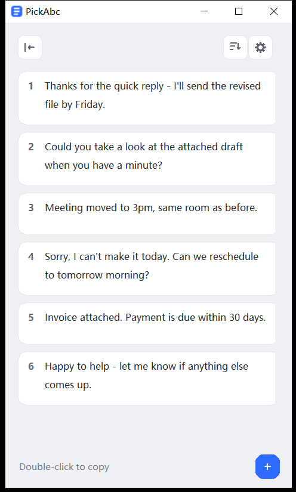

# PickAbc

<a href="https://github.com/joseygo/PickAbc/releases/latest">
  <picture>
    <source media="(prefers-color-scheme: dark)" srcset="assets/badge-download-dark.svg">
    
  </picture>
</a>

**简体中文** · [English](README.en.md)

一个常驻置顶的文本面板：把常用的话存起来，双击就能复制粘贴；不用时拖到屏幕边缘收起，只留一条窄边。



## 下载即用（Windows 10 / 11）

到 [Releases](https://github.com/joseygo/PickAbc/releases) 下载 `PickAbc-1.0.4-win64.zip`，解压后双击 `PickAbc.exe`。
无需安装 Python，无需联网，无第三方依赖，单文件约 10 MB。

## 怎么用

| 操作 | 效果 |
|---|---|
| 双击文本 | 复制到剪贴板（单击不触发，避免误触） |
| 按住文本拖出去 | 拖到任意应用的输入框松手，直接粘贴进去 |
| 右键文本 | 菜单：编辑 |
| 左上角「隐藏」图标 | 一键把整窗收进屏幕左缘，只留一条窄边 |
| 把窗口拖到屏幕左缘松手 | 整窗收进屏幕外，左缘只留一条带 **P** 的窄边；光标碰到窄边就滑回来，光标离开约 1 秒自动再收回 |
| 右上角排序图标 | 按使用次数（双击复制 / 快捷输入 / 拖出都算）降序重排列表 |
| 右上角齿轮 → 设置 | 切换界面语言（English / Deutsch / Español / 简体中文）· 开机自动启动 · 版本更新 · 邮箱 |
| 在任意应用快敲两次同一个数字（11~99） | 弹出确认条，回车确认：抹掉数字，复制对应序号文本并粘贴（全局快捷输入） |
| 右下角 ＋ | 新增文本 |
| 编辑窗口内 ✓ 或 `Ctrl+S` | 保存修改（回车是换行，不是保存） |
| 编辑窗口内「删除」 | 删除该文本 |

窗口默认置顶、贴着屏幕左侧；下缘不会压住任务栏。程序为单实例：已打开时再次双击，会把原窗口提到前面。

## 数据存放

用户数据固定放在 `%APPDATA%\PickAbc`，程序更新不会丢失：

```
%APPDATA%\PickAbc\snippets.json    # 文本
```

**便携模式**：在 `PickAbc.exe` 同目录放一个空文件 `portable.flag`，数据就改存到 exe 旁边。

## 功能说明

- **首次启动**：内置 4 条示例文本，界面语言默认 English（可在右上角齿轮里切换，切换后下次启动保持）；用户全部删光后不会自动复原
- **开机自启**：开关在右上角齿轮菜单里，不写注册表。直接删除 exe 即可卸载，开机不会再报错

## 关于 iOS

本程序基于 Python + Tkinter 桌面框架，**无法打包成 iOS 应用**：iOS 不允许运行 Python
解释器，且要求原生 UIKit 应用。iPhone / iPad 上无法运行。

手机上可用系统自带的「文本替换」（设置 → 通用 → 键盘 → 文本替换）实现类似效果。

## 系统要求

- Windows 10 / Windows 11（64 位）
- 无需管理员权限，不写注册表，无后台服务

## 自己构建（可选）

源码是单文件 `PickAbc.py`，全部标准库（Python 3 + Tkinter），本地跑起来：

```
pythonw PickAbc.py
```

打包成 exe：

```
pip install pyinstaller
python -m PyInstaller PickAbc.spec --noconfirm --clean
```

产物在 `dist/PickAbc.exe`。

## 已知提示

首次运行 Windows 可能弹出 SmartScreen「已保护你的电脑」—— 这是未购买代码签名证书
（每年数千元）的正常现象。点「更多信息」→「仍要运行」即可。

## 版权与许可

PickAbc 为**闭源软件**，仅提供预编译的 Windows 可执行程序；
不提供源码分发或再分发授权。本仓库只发布使用说明与预编译程序，不含源码。

© 2026 Josey。保留所有权利。
