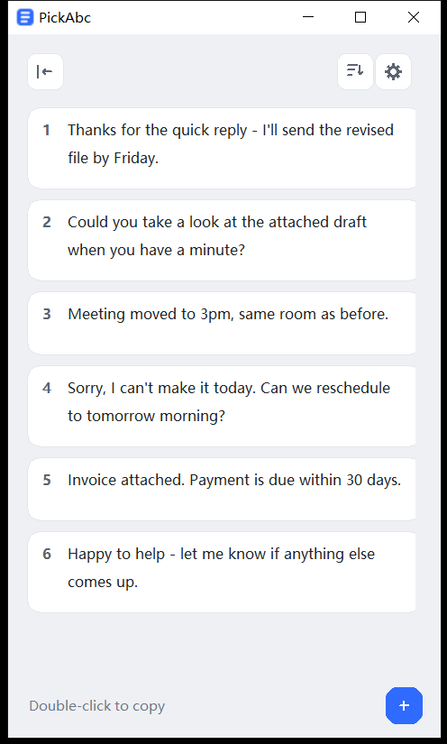

# PickAbc

<a href="https://github.com/joseygo/PickAbc/releases/latest">
  <picture>
    <source media="(prefers-color-scheme: dark)" srcset="assets/badge-download-dark.svg">
    
  </picture>
</a>

**简体中文** · [English](README.en.md)

一个常驻置顶的文本面板：把常用的话存起来，双击就能复制粘贴；不用时拖到屏幕边缘收起，只留一条窄边。



https://github.com/user-attachments/assets/7b22e6f6-07fc-4be7-9879-14ff94a39354

## 下载即用（Windows 10 / 11）

到 [Releases](https://github.com/joseygo/PickAbc/releases) 下载 `PickAbc-1.0.6-win64.zip`，解压后双击 `PickAbc.exe`。
无需安装 Python，无需联网，无第三方依赖，单文件约 10 MB。

## 数据存放

用户数据固定放在 `%APPDATA%\PickAbc`，程序更新不会丢失：

```
%APPDATA%\PickAbc\snippets.json    # 文本
```

**便携模式**：在 `PickAbc.exe` 同目录放一个空文件 `portable.flag`，数据就改存到 exe 旁边。

## 功能说明

- **常驻置顶**：窗口默认置顶、贴着屏幕左侧，下缘不会压住任务栏；程序单实例，已打开时再次双击会把原窗口提到前面
- **首次启动**：内置 5 条示例文本，界面语言默认 English（可在右上角齿轮里切换，切换后下次启动保持）；用户全部删光后不会自动复原
- **开机自启**：开关在右上角齿轮菜单里，不写注册表。直接删除 exe 即可卸载，开机不会再报错

## 系统要求

- Windows 10 / Windows 11（64 位）
- 无需管理员权限，不写注册表，无后台服务

## 自己构建（可选）

源码是单文件 `PickAbc.py`，全部标准库（Python 3 + Tkinter），本地跑起来：

```
pythonw PickAbc.py
```

打包成 exe：

```
pip install pyinstaller
python -m PyInstaller PickAbc.spec --noconfirm --clean
```

产物在 `dist/PickAbc.exe`。

## 已知提示

首次运行 Windows 可能弹出 SmartScreen「已保护你的电脑」—— 这是未购买代码签名证书
（每年数千元）的正常现象。点「更多信息」→「仍要运行」即可。

## 版权与许可

PickAbc 为**闭源软件**，仅提供预编译的 Windows 可执行程序；
不提供源码分发或再分发授权。本仓库只发布使用说明与预编译程序，不含源码。

© 2026 Josey。保留所有权利。
